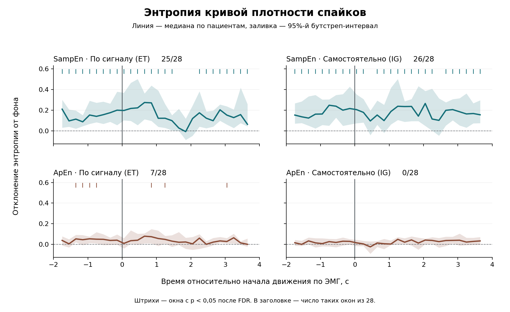
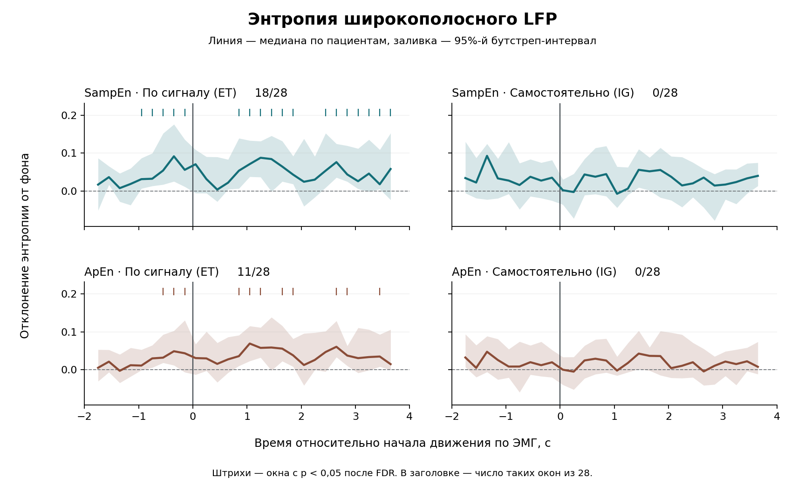

# Энтропийный анализ активности субталамического ядра при движении у пациентов с болезнью Паркинсона

В данной работе исследовалось изменение спайковой активности и потенциалов локального поля (LFP) при движении. Для двух двигательных задач оценивалось изменение регулярности сигналов с помощью выборочной (Sample entropy, SampEn) и приближённой (Approximate entropy, ApEn) энтропию. В одной задаче пациенты двигали кистью по звуковому сигналу (externally triggered, ET), в другой начинали движение самостоятельно (internally generated, IG).

На кривой плотности спайков SampEn выявила повышение относительно фона в 25 из 28 временных окон при ET и в 26 окнах при IG. Для ApEn значимых окон было 7 и 0 соответственно. В широкополосном LFP отклонения обеих мер наблюдались при ET. В объединённых повторах IG значимых окон для LFP не обнаружено.

[ноутбук с расчётами и рисунками](analysis.ipynb)

## Данные и метод

Начало движения определялось по электромиограмме. Для анализа были взяты объединённые повторы каждого типа (ET-all и IG-all). Интервал от −2 до +4 с разбивался на окна длиной 0,5 с с шагом 0,2 с. Спайки представлялись в виде кривой плотности, для LFP использовался широкополосный сигнал с верхней границей 120 Гц. Для LFP порог сходства шаблонов `r` зависел от стандартного отклонения сигнала в текущем окне.

В качестве фона был участок от начала записи до момента за 5 секунд до первого движения. Фоновый уровень энтропии оценивали по медиане значений в 200 случайно выбранных окнах этого участка.

Для каждого пациента отклонения энтропии от фона обобщали по повторам движения и файлам записи. В результате для каждого временного окна получали одно значение на пациента для каждого типа движения, сигнала и метрики. В анализ движений, вызванных внешним сигналом и самоинициированных движений вошли данные 20 пациентов.

## Результаты

| Сигнал | Тип движения | SampEn · значимых окон из 28 | ApEn · значимых окон из 28 |
|:---:|:---:|:---:|:---:|
| Спайковая активность | По сигналу (ET) | 25 | 7 |
| Спайковая активность | Самостоятельно (IG) | 26 | 0 |
| Широкополосный LFP | По сигналу (ET) | 18 | 11 |
| Широкополосный LFP | Самостоятельно (IG) | 0 | 0 |

### Спайковая активность



На одних и тех же записях SampEn чаще выявляла отклонения от фона. Особенно заметно это при самостоятельных движениях: групповые медианы SampEn были выше фона во всех 26 значимых окнах.

### Потенциалы локального поля



При ET-движениях значимые отклонения широкополосного LFP видны и до, и после начала движения.При IG-движениях ни SampEn, ни ApEn не выявили значимых отклонений от фона. Результаты в таблице относятся к проверкам относительно фона внутри каждого условия.

### Как читать рисунки

Линия показывает медиану по пациентам, заливка — поточечный 95%-й бутстреп-интервал медианы. Короткие отметки над кривой обозначают окна с p < 0,05 после поправки Бенджамини–Хохберга. В каждом окне применялся двусторонний критерий знаковых рангов Вилкоксона к отклонениям от фона. Поправка сделана отдельно по 28 окнам каждой комбинации сигнала, метрики и условия. Окна перекрываются, поэтому число значимых окон описывает временной охват эффекта. Единицей наблюдения в каждом тесте служил пациент.

## Воспроизведение

Установите зависимости из папки проекта и откройте ноутбук.

```bash
python -m pip install -r requirements.txt
jupyter notebook analysis.ipynb
```

При выполнении ячеек ноутбук читает обезличенные значения из `data/patient_entropy.csv`, пересчитывает медианы, p-значения и FDR, сверяет результат с `data/reference_statistics.csv` и сохраняет оба рисунка в `figures/`. Эталонная таблица служит для проверки и не участвует в расчёте статистики.
